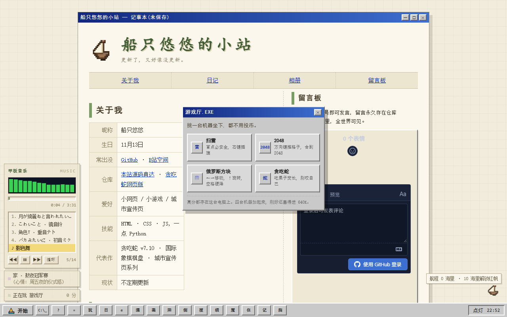
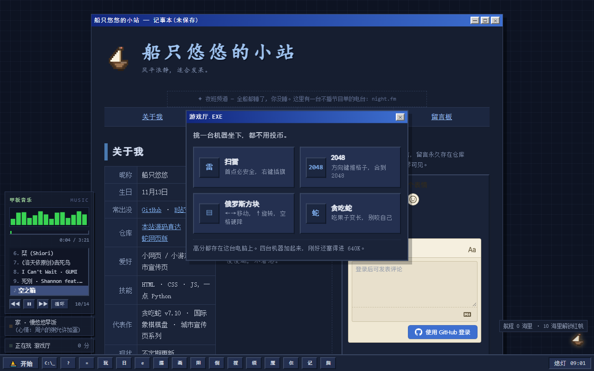
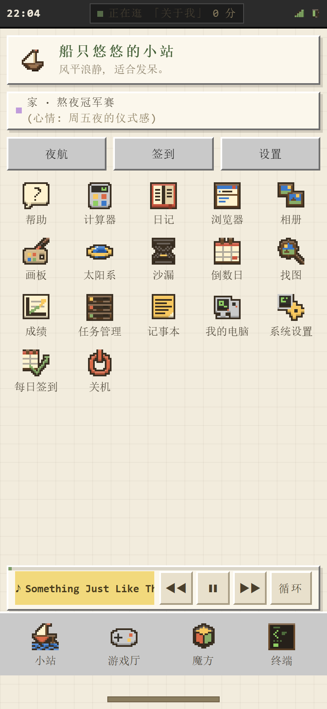
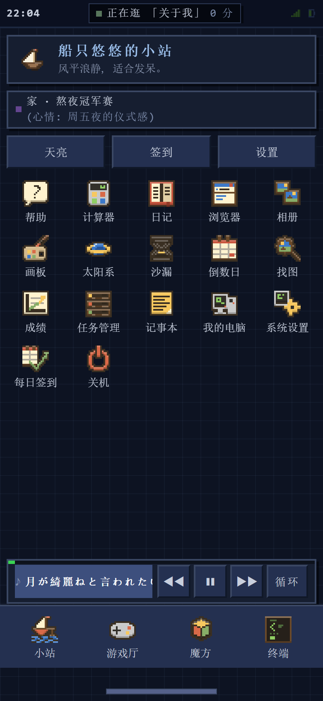
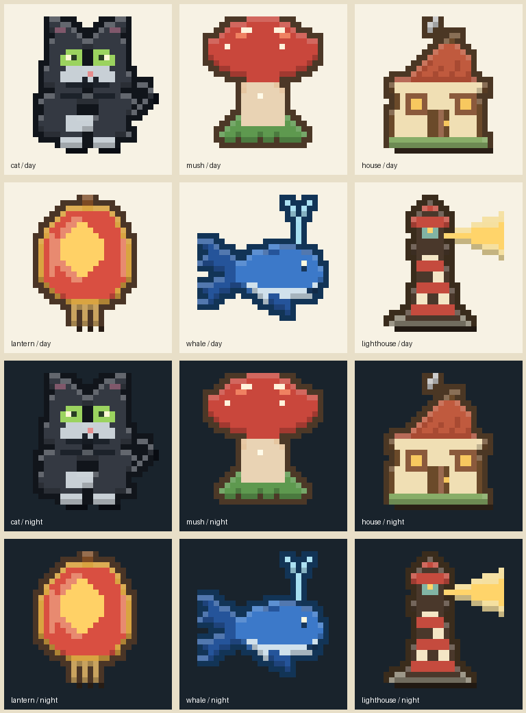
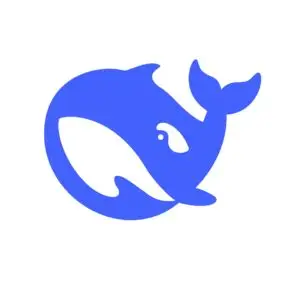
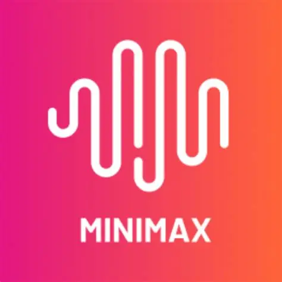

# ⛵ 船只悠悠的小站

> 一条慢悠悠的船，泊在互联网边上。
> 一个整站伪装成"一台老电脑"的手写个人主页——从开机动画、桌面窗口、任务栏，到 CRT 关机、BIOS 重启，全流程都是戏。

**在线访问**：[wezhce.github.io/The-small-station-of-drifting-boats](https://wezhce.github.io/The-small-station-of-drifting-boats/)

**仓库直达**：[github.com/WEZHCE/The-small-station-of-drifting-boats](https://github.com/WEZHCE/The-small-station-of-drifting-boats)

**宣传视频**：[bilibili.com/video/BV1TNHK6SEhv](https://www.bilibili.com/video/BV1TNHK6SEhv/)

| 白天 | 夜航模式（19:00~6:00 自动开启） |
|---|---|
|  |  |

## ✨ 它是什么

- 纯 `HTML + CSS + JS` 单文件手写，**没有框架、没有后端、没有构建**，全部代码在一个 `index.html` 里
- 复古 Win98 视觉：记事本窗口、凹凸按钮、手绘像素画、CRT 开机
- 页脚挂着友情链接：城市宣传页 / 棋艺对弈 / 体素古建 / 贪吃蛇网页（船长的新项目）— 还有仓库直达的超链接
- 留言板基于 GitHub Discussions（[giscus](https://giscus.app/zh-CN)），留言永久保存在本仓库里，全世界可见

## 🖥 这台"电脑"有什么

**开机与关机**
- 粒子汇聚开机动画（每个浏览器会话只播一次，尊重系统"减少动态效果"设置，可在网站设置里关闭）
- 首次到访弹出「欢迎登船」信：像素小船 + 站名 + 第 N 次登船（本地计数）+ 头衔徽章 + **舱位表**（硬边像素表格，把船上现在装着什么按 玩 / 拧 / 看 / 读 / 听 / 藏 六类摊开，秘密数和开船天数都是活的）+ **码头**（四个按钮：看看最近的日记 / 翻一本相册 / 拧一把魔方 / 领一张像素船票，点了直接把人带走）+ 设备建议；游客信息里可重读
- 开始菜单 → 关机：CRT 白线坍缩收场；船侧翻睡觉冒 Zzz；再点电源键，BIOS 自检打字 + 蜂鸣，白闪重新开机

**桌面与任务栏**
- 任务栏：开始菜单（系统与设备 / 网站设置：屏保时长·夜航·音效·开机动画 / 游客信息：第 N 次上船·来路·设备·秘密清单·像素船票 / 每日签到：+5 海里连签翻倍 / 关机）、cmd、帮助.chm、计算器、游戏厅.EXE（一个门里四台机器：扫雷——首点必安全、右键或长按插旗；2048——方向键或 WASD 推格子，也能在棋盘上滑；顶栏挂一条本机最高分纪录（边玩边存，不用等这局结束）、底下「撤销」能退回上一步（键盘按 Z 也能退）；俄罗斯方块——← → 移动、↑ 旋转、↓ 加速、空格直接落底、P 暂停，7 种方块 7-bag 随机、消行升级提速；手机上多一只摇杆，左右挪按住连发、上转下加速、旁边一个「落底」；贪吃蛇——吃果子变长，每 50 分提速一档；手机上摇杆推向哪边就往哪边转；四台机器的高分都留在本机，关掉一台自己走回厅里换机）、魔方.EXE（二阶 / 三阶 / 四阶都能玩：拖画布转视角、点面就拧一层（点右半边顺时针、左半边逆时针）、底下十二个键也能直接拧；手机上松手还能再滑一截，按住不动半秒回正，底下按钮在窄屏排成四列、保证手指头点得下；三阶用 Kociemba 两阶段法现算（建表约半秒，解一步十几到几十毫秒），二阶把八个角搬进一个棱块全归位的三阶局面再解，四阶先降阶成三阶再解、奇偶情况会自动修正；打乱 / 还原 / 重置 / 回正 / 暂停 / 单步都有，还原了自动记成绩，各阶成绩分开留在本机）、日记.EXE、小站浏览器（船际网络认证站点：复古主页/船舱BBS/气象台/灯塔日报/舰载电视台——节目单就是甲板音乐，点谁谁开唱/海妖软件站——"安装"即打开对应应用，还有永远下载失败的 640K 内存扩容包/船际相簿馆——点一本相册.EXE 替你翻开/漂流瓶邮局——真捞留言板里的瓶子；另有隐藏站点等你乱输网址，乱输还有老式 404）、沙漏.EXE（像素沙漏倒计时，沙子流动可视化）、画板.EXE（24×24 像素画板：画笔/油漆桶/橡皮/撤销，画完一键下载 PNG）、太阳系.EXE（真实比例+真实轨道周期：左侧星球列表点谁去谁、拖动平移、滚轮缩放、点行星看资料并锁定镜头，缩到最小说明什么叫"空"）、倒数日.EXE（内置节日与纪念日倒数：公历固定节日 25 个（含情人节、植树节、女生节、妇女节、世界地球日、世界读书日、国际博物馆日、全国爱眼日、世界海洋日、教师节、世界动物日、萝莉日 10-28/世界动画日、万圣节、平安夜）、农历节日 11 个（春节·元宵·龙抬头·端午·七夕·中元·中秋·重阳·腊八·小年·除夕，排到 2032）、二十四节气 5 个、母亲节父亲节（日子会跑，每年现算）+ 自动追最近的周五 + 自定义事件可写详细说明；桌面两列排、窄屏退回一列，字和按钮都放大一号，每张卡带一个历法角标（公历/农历/节气/每周/自己写）；存在本地，谁的日子近谁排前面）、图片搜索.EXE（按内容和标签找图：输入"猫/操场/云/毕业"这类关键词或点标签，命中高亮，点结果直达大图）、成绩监控.EXE（加密成绩档案：口令解锁才能翻，源码里只存密文，关窗重新上锁；四场卷子——开学考、两次月考、冀豫联考，名次都是校里排的，每场都能跟上次直接比「较上次」那一列）、任务管理器.EXE（应用/进程/性能三页账：进程表里住着 AI 船员——二十个 ChatGPT 和干饭冠军 GLM；性能页是真数据——帧率掉帧+输入事件算负载、JS 堆内存真实曲线（能看到 GC 锯齿）、每个窗口统计真实 DOM 对象数和画布内存；640K 内存账精确对上蓝屏线，任务管理器自己也占 42K）、记事本.EXE（自动保存的草稿纸，只存在本机）、我的电脑（C:\ 小站的文件浏览器：目录是假的，回忆是真的）、托盘点灯、真实时钟（夜航整栏换深夜配色）
- 仿真 cmd：启动 banner、`↑↓` 历史命令、`help / ver / echo / tree / start / sudo` 等一整套命令（彩蛋无数）
- 帮助.chm：全站彩蛋的官方使用手册（弹窗，可拖动；翻开前有一道"剧透警告"确认，可勾选不再问）
- 所有窗口都能拖标题栏移动、点击置顶；手机上用手指拖也行，拖到屏幕边上会自己停住，不会把窗口弄丢

**📱 手机上另有一台「远古 iPhone」**
- 窄屏（≤760px）时自动换成手机壳：黑条状态栏（时钟 / 灵动岛 / 信号格 / 电池像素图）、站名 banner、船长状态面板、5 列弹簧板 17 个手绘 16×16 像素图标、底部一条甲板音乐、四个常驻（小站 / 游戏厅 / 魔方 / 终端）

| 白天 | 夜航模式 |
|---|---|
|  |  |

- 点图标即全屏打开对应应用（魔方、终端、日记、相册、画板、太阳系、任务管理器……共 21 个），顶部留一条应用标题栏，底部横杠回到主屏
- **旧版桌面界面原样保留**：手机壳是"另加的一台机器"，不是把旧的改掉；系统属性 → 设置里有「手机壳」开关（网站设置里），开着=窄屏自动用手机壳，关着=永远用旧界面；没手动选过就跟着屏幕宽度走
- 桌面浏览器里也能预览：宽屏时手机壳会在页面正中摆成一台 390×844 的小手机，旧界面在后面照旧
- 手机档另有一批适配：所有可点的东西手指头点得下（≥40px）、最小字号 13px、魔方提示换成手指那套（点面拧层 / 松手滑一截 / 长按回正）
- **贪吃蛇和俄罗斯方块配了摇杆**：窄屏下原来的十字键和四个箭头换成一只像素摇杆（底座 + 蓝头，手绘 16×16 精灵，夜航自动换暗色板）——贪吃蛇推向哪边就往哪边转；俄罗斯方块左右挪（按住能连发）、上转、下加速，旁边另配一个「⇓ 落底」按钮；桌面上还是键盘和原来的按键，一点没变
- 旧界面在窄屏上也补了一轮：任务栏改成一行横着划（不再折成三行吃掉半个屏）、甲板音乐收成贴底一条、小字统统抬到 13px
- **每个应用都按窄长屏重排过一遍**（22 扇窗挨个改）：按钮一律抬到 ≥40px、小字抬到 ≥13px、输入框给到 44px 高、画布不许被 flex 拉扁、太阳系的行星列表改成 5+4 两行、扫雷九列在窄机器上横着划而不是把格子按小
- **平板不再被手机壳接管**：以前只要是触摸设备（`pointer:coarse`），哪怕 820px 宽的平板也会自动摆出一台 390px 的小手机压在网页上——现在壳只在 ≤760px 的窄屏上接管，平板老老实实走旧界面；平板档另配了一套：任务栏 18 个键缩一号一行放下、甲板音乐压成贴底一条
- **留言板在窄屏和平板上不再重叠**：giscus 在窄屏上不回报高度，iframe 会一直卡在 150px，把底下的漂流瓶、搜索框、便利贴全压住；现在窄屏给 iframe 一个兜底高度
- **相册封面按屏幕宽度换排法**：窄屏只露一张大图、平板四张横排，网格列数跟着宽度走（不再固定 3 列挤成每格一百来像素）

**内容板块**
- 关于我 / 船舱日记（GUI 日历 + 红点标记录日期，近况与日记统一时间线，项目带仓库链接）/ 相册（十五本板块相册，已开张十一本：像素画集、捣鼓token、校园时光、船长的画、摄影作品、生活碎片、九小回忆、神秘一高、出去玩、好吃的、小东西，其余四本虚位以待；主页面只陈列封面与简介，双击封面或点「翻开相册」在独立的 相册.EXE 窗口里查看全部图片；灯箱浏览，←→ 切换，支持**单张下载**与**整本打包带走**；**每张照片都能单独留言**——点大图下方的「💬 这张的留言」就为那张照片开一条独立的讨论串（登录 GitHub 即可写，换照片自动收起，没人留言就不会在仓库里留下空帖子））/ 留言板（giscus + 全文搜索）
- 漂流瓶：一键从留言里随机捞一条陌生人的话
- 左下角三块面板：甲板音乐（像素频谱播放器，已上架二十七首——初音ミク / 镜音铃 / 重音テト / GUMI / 洛天依等 VOCALOID，加上《東方》Bad Apple!!、千本桜、カプチーノ、深海少女、说谎的你，再加 Something Just Like This / See You Again /《玲音》OP Duvet / Heaven /《烟草》等英文歌与动漫主题曲；舰载电视台的节目单就是这张歌单，点谁谁开唱；开站随机播放，播放器跟着音频元素自己的状态走，耳机 / 系统媒体键按暂停，按钮和频谱也一起停）+ 船长状态（课表 + 学生法定节假日双驱动的状态灯：地点 / 事情 / 心情，寒暑假、小长假、周末、调休补课自动切换）+ 灵动岛（实时显示游客正在浏览的板块 / 打开的应用 / 正在输入 / 挂机状态，记录本次上船时长；在记事本、终端、找图框里打字会单独认出来，不会因为鼠标没动就误报挂机）

像素画集的黑猫、蘑菇、小屋、灯笼、鲸鱼和灯塔已按 24×24 网格重绘。下图是白天与夜航底色上的像素渲染预览：



**彩蛋（冰山一角，完整清单在站内 帮助.chm）**
- 站名 / 副标题 / 运行天数 / 板块标题 / 便利贴 / 时钟——挨个点过去，全都有回应
- **秘密清单**：全站藏着 18 个秘密，撞到一个记一个，游客信息里看账
- **每日签到**：开始菜单里签到 +5 海里，连签 7 天翻倍；游客信息里能领**像素船票**（canvas 手绘，可下载 PNG）
- 小船养成：点右下角小船攒航程，10 海里红帆 / 30 海鸥 / 60 金帆 / 100 夜灯
- Konami Code（`↑↑↓↓←→←→BA`）触发彩虹模式，再输一遍关闭
- 60 秒不动鼠标，屏保自己开演：小船在星空里替你开船；屏保里**按任意键**变成躲避陨石的小游戏，最高分本机保留
- 同时开 4 个应用触发蓝屏（640K 内存的极限）：任意键退出，全部窗口关闭；蓝屏次数会被任务管理器记进"蓝屏纪念册"
- 夜航模式：整站深夜海色，小船点灯，giscus 同步换夜主题；夜里主页还有一条只在夜航出现的"夜班频道"

## 🗂 仓库结构

```
├── index.html       全站本体（单文件应用，含全部样式与脚本）
├── 404.html         404 彩蛋页（翻船 + 回甲板）
├── theme.css        giscus 白天主题（羊皮纸）
├── theme-night.css  giscus 夜航主题（深夜海色）
└── docs/            截图与相册图片（campus 校园实拍 / yigao 神秘一高 / trip 出去玩 / food 好吃的 / small 小东西 / tokens 燃料账单 / art 船长的画 / photo 摄影作品 / life 生活碎片 / jx 九小回忆）
```

## 🔧 想改成你自己的？

所有内容都在 `index.html` 里，搜索关键词即可定位：

| 想改什么 | 搜哪里 |
|---|---|
| 昵称 / 生日 / 社交链接 | `关于我` |
| 日记与近况条目 | `var ENTRIES` |
| 船舱日记 | `var DIARY` |
| 每日副标题 / 宜忌语录 | `SUBS` / `YI` / `JI` |
| 留言板配置 | `GISCUS_CFG`（仓库需开启 Discussions 并安装 [giscus 应用](https://github.com/apps/giscus)） |
| 像素画 | `SPRITES`（多尺寸字符画，像素画集为 24×24；渲染器自动加描边 / 受光 / 投影 / 光晕） |

## ▶ 本地预览

直接双击 `index.html` 即可（留言板、漂流瓶等功能需要联网）。
或者起个静态服务器：`npx serve .`

## 🤝 贡献者

**船长 · [船只悠悠](https://github.com/WEZHCE)**（[B站](https://space.bilibili.com/1309420497)）— 全部代码的手写人

**AI 船员**

| [DeepSeek](https://github.com/deepseek-ai) | [GLM](https://github.com/zai-org) | [ChatGPT](https://chatgpt.com/) | [MiniMax](https://github.com/MiniMax-AI) |
|:---:|:---:|:---:|:---:|
| <a href="https://github.com/deepseek-ai"></a> | <a href="https://github.com/zai-org"></a> | <a href="https://chatgpt.com/"></a> | <a href="https://github.com/MiniMax-AI"></a> |
| AI 助手 | AI 助手 | AI 助手 | AI 助手 |


## 📄 其他

- © 2026 船只悠悠 — 手写，慢慢更新
- 留言数据保存在本仓库的 [Discussions](https://github.com/WEZHCE/The-small-station-of-drifting-boats/discussions) 里
